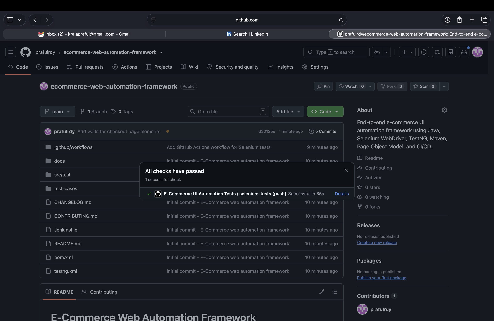

# E-Commerce Web Automation Framework

Portfolio UI automation framework built with **Java, Selenium WebDriver, TestNG, Maven, Page Object Model, GitHub Actions, and Jenkins**.

## Automated Flows
- Valid and invalid login
- Product sorting
- Add product to cart
- Cart validation
- End-to-end checkout
- Headless CI execution

## Run locally
```bash
mvn clean test
```

Headless:
```bash
mvn clean test -Dheadless=true
```

## Structure
```text
src/test/java/base
src/test/java/pages
src/test/java/tests
src/test/java/utils
src/test/resources/testdata
docs
test-cases
.github/workflows
```
## CI/CD Test Execution

GitHub Actions automatically runs the Selenium regression suite in headless Chrome on every push and pull request.


